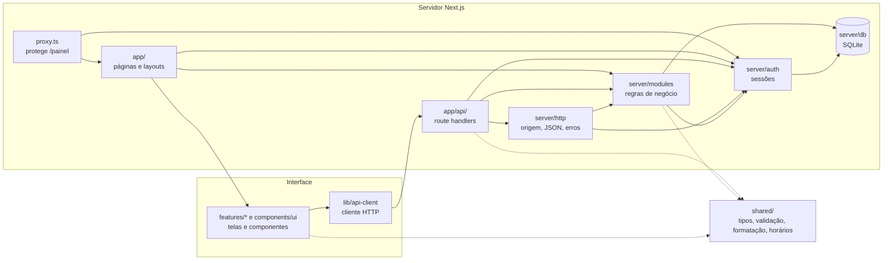

# Arquitetura

O BarbApp é um monólito modular em **Next.js 16 (App Router), React 19 e TypeScript**. A mesma aplicação entrega as páginas, a API HTTP e o acesso ao banco SQLite. O código é organizado em camadas com responsabilidades e dependências bem definidas, para que qualquer parte seja encontrada pelo nome da pasta.

## Visão geral



| Camada         | Pasta               | Responsabilidade                                                                                                                                                                                                           |
| -------------- | ------------------- | -------------------------------------------------------------------------------------------------------------------------------------------------------------------------------------------------------------------------- |
| Rotas          | `src/app`           | URLs, layouts, metadados e route handlers. Apenas compõe as outras camadas.                                                                                                                                                |
| Apresentação   | `src/features`      | Telas e componentes de cada funcionalidade. Os interativos são Client Components (`"use client"`), pré-renderizados no servidor e hidratados no navegador; `site/screens` são Server Components.                           |
| Design system  | `src/components/ui` | Componentes visuais reutilizáveis e sem regra de negócio.                                                                                                                                                                  |
| Cliente HTTP   | `src/lib`           | `api-client.ts`, usado pela interface para chamar a API. Os dados iniciais chegam por props das páginas e, no painel, pelo layout via `DashboardProvider`; a exportação CSV é um link direto para `/api/dashboard/export`. |
| Back-end       | `src/server`        | Regras de negócio, persistência, sessões e segurança. Executa apenas no servidor.                                                                                                                                          |
| Contrato comum | `src/shared`        | Tipos, schemas Zod, formatação e cálculo de horários usados pelos dois lados.                                                                                                                                              |
| Estilos        | `src/styles`        | CSS global dividido por área, importado em ordem por `globals.css`.                                                                                                                                                        |

## Estrutura de pastas

```text
src/
├── app/                              Rotas do Next.js
│   ├── layout.tsx                    HTML raiz, estilos globais e notificações
│   ├── error.tsx, loading.tsx, not-found.tsx   Erro, carregamento e página 404
│   ├── (public)/                     Site público, acesso e agendamento
│   │   ├── layout.tsx                Cabeçalho e rodapé públicos
│   │   ├── page.tsx                  /
│   │   ├── [info]/page.tsx           /sobre-nos, /ajuda, /novidades, /desenvolvedores, /privacidade, /termos
│   │   ├── acesso/ registro/         Login e cadastro
│   │   ├── agendar/                  Agendamento público
│   │   └── agendamento/[token]/      Consulta, cancelamento e remarcação pelo link
│   ├── painel/                       Área privada (layout.tsx exige sessão e carrega os dados)
│   └── api/                          API HTTP, uma pasta por recurso
│       ├── [...path]/                404 em JSON para caminhos desconhecidos
│       └── dashboard/[...path]/      Mesmo 404, depois de exigir a sessão
├── features/                         Funcionalidades da interface
│   ├── site/                         Cabeçalho, rodapé, início e páginas institucionais
│   ├── auth/                         Formulário de acesso e cadastro
│   ├── booking/                      Fluxo de agendamento e gestão pelo link
│   └── dashboard/                    Painel: contexto, shell, gráficos e telas
├── components/ui/                    Button, Modal, EmptyState, ErrorMessage, Logo
├── lib/api-client.ts                 fetch para /api com tratamento de erro e sessão
├── server/                           Back-end
│   ├── config.ts                     Variáveis de ambiente
│   ├── errors.ts                     AppError (erro de negócio com status HTTP)
│   ├── bootstrap.ts                  Abre o banco e cria a demonstração, quando habilitada
│   ├── demo.ts                       Conta e dados fictícios da demonstração
│   ├── db/                           connection.ts (SQLite e transações) e schema.ts (esquema e migrações)
│   ├── auth/                         Sessões no banco e no cookie
│   ├── security/                     Senhas, tokens e limite de tentativas
│   ├── http/                         handler.ts (publicRoute, privateRoute), leitura do corpo e respostas
│   └── modules/                      Regras por entidade
├── shared/                           Código isomórfico
├── styles/                           CSS por área; overrides.css é importado por último
├── instrumentation.ts                Inicializa o banco uma vez, na partida do servidor
└── proxy.ts                          Redireciona /painel sem sessão para /acesso
```

Dentro de `server/`, as dependências seguem um único sentido: `http` usa `auth` e `modules`; `modules` usa `auth`, `security`, `demo` e `db`; `auth` usa `security`, `demo` e `db`; `demo` usa `security` e `db`; `security` usa `db`. `config.ts` e `errors.ts` não dependem de nada, e `bootstrap.ts`, que usa `db`, `demo` e `config`, só é carregado por `instrumentation.ts`. Nenhuma pasta importa outra que esteja acima dela.

Dentro de `features/`, `screens/` reúne o que uma página renderiza e `components/` reúne as partes usadas apenas por aquela funcionalidade. Uma página em `app/` normalmente tem poucas linhas: carrega dados do servidor quando necessário e entrega uma tela.

## Regras de dependência

| Camada              | Pode importar                                            | Não pode importar                                   | Como é garantido                                                                     |
| ------------------- | -------------------------------------------------------- | --------------------------------------------------- | ------------------------------------------------------------------------------------ |
| `features`          | `shared`, `components`, `lib` e a própria funcionalidade | `server`, `app` e outras funcionalidades            | ESLint (`no-restricted-imports`) e `server-only` na compilação dos Client Components |
| `components`, `lib` | `shared`, `components`, `lib`                            | `server`, `app`, `features`                         | ESLint (`no-restricted-imports`) e `server-only` na compilação dos Client Components |
| `shared`            | Bibliotecas puras, como Zod                              | Qualquer outra camada, módulos do Node.js, `next/*` | ESLint                                                                               |
| `server`            | `shared` e o próprio `server`                            | `features`, `components`, `lib`, `app`              | ESLint                                                                               |
| `app`               | Todas as camadas                                         | —                                                   | Revisão de código: apenas compõe, sem lógica própria                                 |

As regras do ESLint valem tanto para imports com o alias `@/` quanto para caminhos relativos. Todos os arquivos de `src/server` começam com `import "server-only"`: se um Client Component importar código do servidor, mesmo indiretamente, a compilação falha. Isso impede que consultas SQL, hashes ou variáveis de ambiente cheguem ao pacote enviado ao navegador. Os testes unitários e os scripts executam o mesmo código com `tsx --conditions=react-server`.

## Fluxo de uma requisição

Exemplo: um cliente confirma um horário.

1. `features/booking/screens/booking-flow.tsx` chama `api("bookings", { method: "POST" })`.
2. `app/api/bookings/route.ts` recebe a requisição através de `publicRoute` (`server/http/handler.ts`), que verifica a origem e converte erros em respostas JSON. O banco já foi aberto e migrado por `instrumentation.ts` na partida do servidor.
3. A rota valida o corpo com `bookingSchema` (`shared/validation.ts`) e aplica `rateLimit` por telefone.
4. `server/modules/bookings.ts` abre uma transação, confere o horário com `generateSlots` (`shared/availability.ts`), cria ou reaproveita o cliente e grava o atendimento.
5. O gatilho `prevent_appointment_overlap` do SQLite impede sobreposição mesmo em requisições concorrentes.
6. A resposta `201` traz o token do link de gestão; a tela navega para `/agendamento/<token>`, cuja página mostra a confirmação.

As rotas privadas usam `privateRoute`, que exige sessão válida e entrega à rota o usuário e o estabelecimento dele. Nenhum identificador de estabelecimento é aceito do cliente nas operações privadas.

## API

| Método        | Rota                                     | Acesso  | Função                                                      |
| ------------- | ---------------------------------------- | ------- | ----------------------------------------------------------- |
| GET           | `/api/auth/me`                           | Público | Usuário da sessão atual ou `null`                           |
| POST          | `/api/auth/register`                     | Público | Cria responsável e estabelecimento e abre a sessão          |
| POST          | `/api/auth/login`                        | Público | Abre a sessão                                               |
| POST          | `/api/auth/logout`                       | Público | Encerra a sessão                                            |
| POST          | `/api/auth/demo`                         | Público | Entra na conta de demonstração, quando habilitada           |
| GET           | `/api/businesses?q=`                     | Público | Busca barbearias                                            |
| GET           | `/api/catalog/:businessId`               | Público | Barbearia, serviços e profissionais ativos                  |
| GET           | `/api/slots`                             | Público | Horários livres por barbearia, profissional, serviço e data |
| POST          | `/api/bookings`                          | Público | Cria um agendamento                                         |
| POST          | `/api/waitlist`                          | Público | Entra na lista de espera                                    |
| GET, PATCH    | `/api/manage/:token`                     | Link    | Consulta e remarca o agendamento                            |
| GET           | `/api/manage/:token/slots?date=`         | Link    | Horários livres para remarcação                             |
| POST          | `/api/manage/:token/cancel`              | Link    | Cancela o agendamento                                       |
| GET           | `/api/dashboard` e `/api/dashboard/data` | Sessão  | Todos os dados do painel                                    |
| GET           | `/api/dashboard/export`                  | Sessão  | CSV dos agendamentos                                        |
| PATCH         | `/api/dashboard/appointments/:id`        | Sessão  | Altera o status de um atendimento                           |
| POST          | `/api/dashboard/services`                | Sessão  | Cria um serviço                                             |
| PATCH, DELETE | `/api/dashboard/services/:id`            | Sessão  | Edita e arquiva um serviço                                  |
| POST          | `/api/dashboard/professionals`           | Sessão  | Cria um profissional                                        |
| PATCH, DELETE | `/api/dashboard/professionals/:id`       | Sessão  | Edita e arquiva um profissional                             |
| POST          | `/api/dashboard/customers`               | Sessão  | Cria um cliente                                             |
| PATCH         | `/api/dashboard/customers/:id`           | Sessão  | Edita um cliente                                            |
| PATCH         | `/api/dashboard/business`                | Sessão  | Dados e expediente do estabelecimento                       |
| PATCH         | `/api/dashboard/account`                 | Sessão  | Nome do responsável                                         |
| PATCH         | `/api/dashboard/password`                | Sessão  | Troca a senha e encerra as outras sessões                   |
| PATCH         | `/api/dashboard/waitlist/:id`            | Sessão  | Status de um registro da lista de espera                    |

Caminhos desconhecidos abaixo de `/api/` respondem `404` em JSON para GET, POST, PATCH e DELETE, pelos fallbacks `api/[...path]` e `api/dashboard/[...path]`. Em `/api/dashboard/*`, a sessão é exigida antes, então quem não está autenticado recebe `401`. Um método não suportado por uma rota existente recebe `405`. Todas as respostas JSON usam `Cache-Control: no-store, private`.

## Dados

| Tabela                  | Conteúdo                                                                         |
| ----------------------- | -------------------------------------------------------------------------------- |
| `users`, `sessions`     | Responsáveis e hashes das sessões ativas                                         |
| `businesses`            | Estabelecimento de cada responsável e expediente semanal (JSON)                  |
| `professionals`         | Equipe, disponibilidade semanal, pausas e datas bloqueadas (JSON)                |
| `services`              | Serviços com preço em centavos e duração em minutos                              |
| `service_professionals` | Quais profissionais realizam cada serviço                                        |
| `customers`             | Clientes por estabelecimento, únicos por telefone                                |
| `appointments`          | Atendimentos com cópia do nome, preço e duração do serviço no momento da reserva |
| `waitlist`              | Lista de espera, sem duplicatas por cliente, data, serviço e profissional        |
| `rate_limits`           | Contadores de tentativas por chave                                               |
| `migrations`            | Versões de esquema aplicadas                                                     |

O esquema e as migrações ficam em `server/db/schema.ts`. Uma nova migração é um item a mais na lista `migrations`, aplicado uma única vez dentro de uma transação.

## Segurança

- Senhas com `scrypt` e salt individual; tokens de sessão e de agendamento com 256 bits aleatórios, guardados no banco apenas como hash SHA-256.
- Cookie de sessão `HttpOnly`, `SameSite=Lax` e `Secure` quando `APP_URL` usa HTTPS.
- Verificação de `Origin` em toda requisição que altera dados.
- Limite de tentativas persistido no SQLite para login, cadastro, demonstração, troca de senha, reservas e lista de espera.
- Isolamento por estabelecimento: as consultas privadas sempre filtram pelo estabelecimento do usuário autenticado.
- Exportação CSV protegida contra injeção de fórmulas.

## Testes e qualidade

| Comando                | Verifica                                                                  |
| ---------------------- | ------------------------------------------------------------------------- |
| `npm run typecheck`    | Tipos das rotas gerados pelo Next.js e TypeScript estrito                 |
| `npm run lint`         | Regras do Next.js, React e as fronteiras entre camadas                    |
| `npm run format:check` | Formatação conforme o Prettier                                            |
| `npm test`             | `tests/unit`: horários, validação, segurança e regras de negócio no banco |
| `npm run test:e2e`     | `tests/e2e`: a API por HTTP, com duas contas isoladas e banco próprio     |
| `npm run build`        | Compilação de produção, incluindo a verificação do `server-only`          |

A integração contínua em `.github/workflows/ci.yml` executa todas essas etapas.

## Onde colocar código novo

| Preciso de...                        | Lugar                                                                                                   |
| ------------------------------------ | ------------------------------------------------------------------------------------------------------- |
| Uma nova página                      | `src/app/.../page.tsx` renderizando uma tela de `src/features`                                          |
| Uma nova tela ou parte de tela       | `src/features/<funcionalidade>/screens` ou `components`                                                 |
| Um componente visual genérico        | `src/components/ui`                                                                                     |
| Um novo endpoint                     | `src/app/api/<recurso>/route.ts` usando `publicRoute` ou `privateRoute` de `src/server/http/handler.ts` |
| Uma regra de negócio ou consulta SQL | `src/server/modules/<entidade>.ts`                                                                      |
| Uma validação usada pelos dois lados | `src/shared/validation.ts`                                                                              |
| Uma alteração no banco               | Nova entrada em `migrations` em `src/server/db/schema.ts`                                               |
| Estilos                              | O arquivo da área em `src/styles`; `overrides.css` vem por último e prevalece                           |

## Legado

A primeira versão (React com Create React App, API em Python com Flask e MongoDB, e a modelagem `estruturaDB.sql`) está em `legacy/`, apenas para consulta e com remoção prevista. Ela fica fora do TypeScript, do ESLint, do Prettier e da imagem Docker. Veja `legacy/README.md`.
